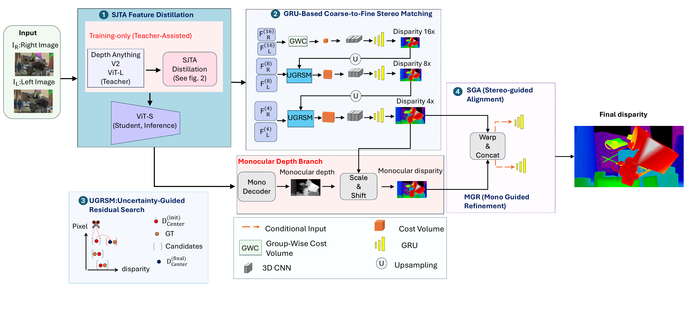
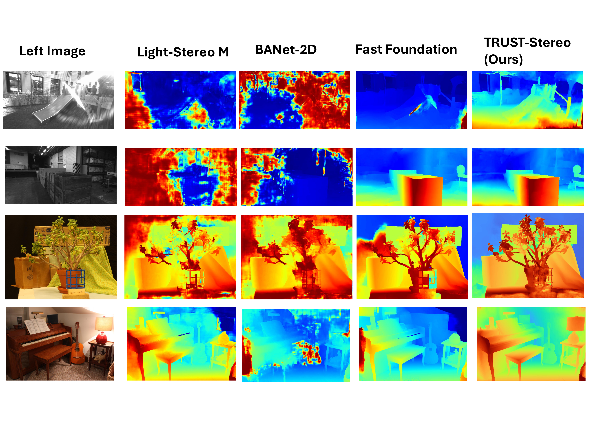
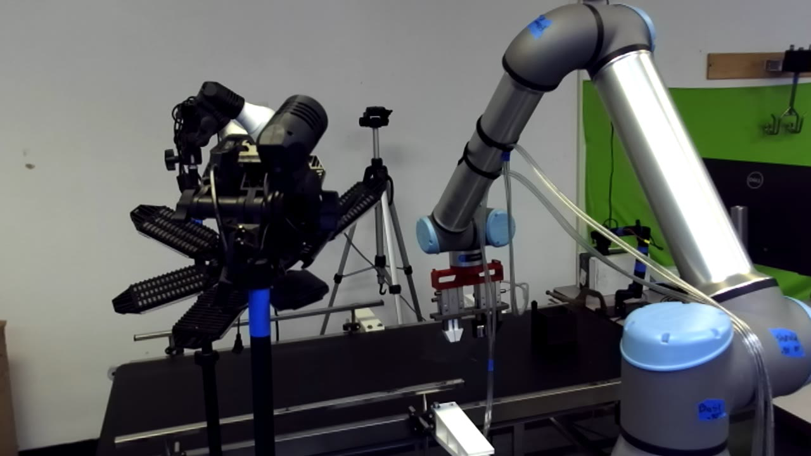
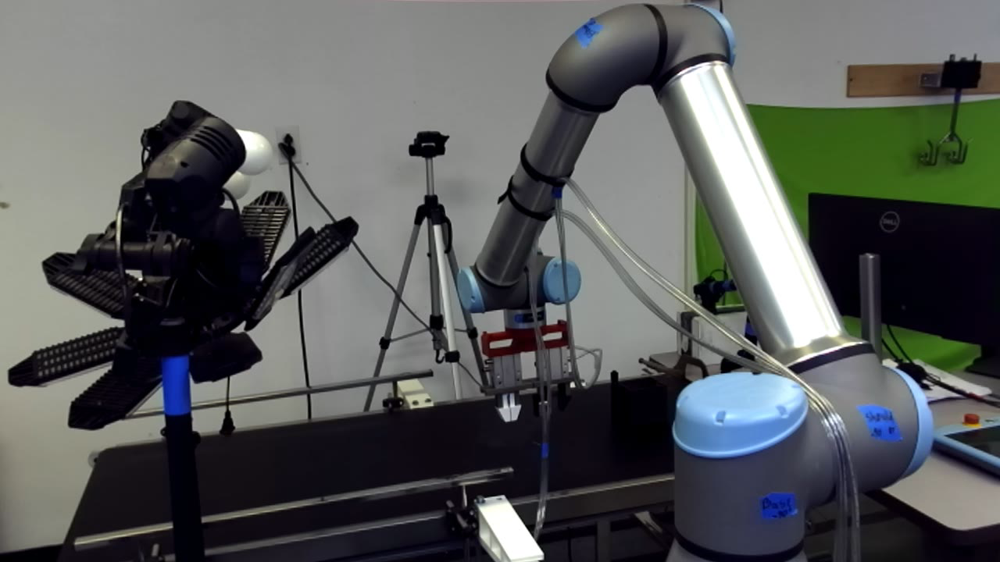
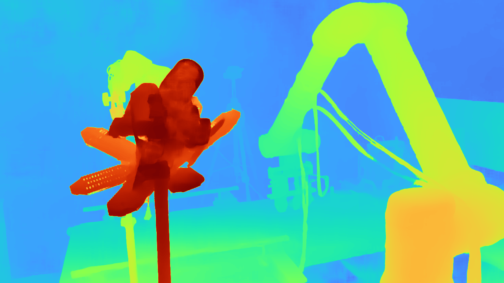
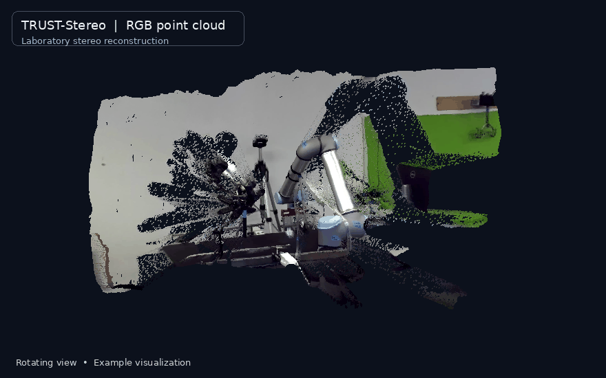

<div align="center">

# TRUST-Stereo

### Teacher-Assisted Robust Uncertainty-Guided Search and Transfer for Fast Stereo Matching

**Fast stereo matching · Zero-shot generalization · Full-resolution disparity prediction**

[Overview](#overview) · [Abstract](#abstract) · [Results](#results) · [Installation](#installation) · [Inference](#zero-shot-inference) · [Citation](#citation)

</div>

TRUST-Stereo is a coarse-to-fine stereo matching framework that combines **Senior–Junior Teacher Assistant (SJTA)** knowledge distillation with an **Uncertainty-Guided Residual Search Module (UGRSM)**. It improves stereo feature representations while making local correspondence search more robust to errors propagated from coarser disparity estimates.

The framework uses a lightweight student backbone at inference and predicts a **dense disparity map at the input image resolution** from a pair of rectified RGB images.

## Abstract

Coarse-to-fine stereo matching enables efficient disparity estimation but remains sensitive to errors in propagated disparity, which may place ground-truth correspondences outside subsequent local search ranges. We propose TRUST-Stereo (**T**eacher-Assisted **R**obust **U**ncertainty-Guided **S**earch and **T**ransfer for fast **Stereo**), which addresses this limitation through an Uncertainty-Guided Residual Search Module (UGRSM). UGRSM estimates the reliability of propagated disparity and predicts residual offsets to adaptively relocate local cost-volume centers. Additionally, we introduce a two-stage Senior–Junior Teacher Assistant knowledge distillation strategy to transfer rich monocular representations from a large foundation model to a lightweight backbone to achieve real-time stereo matching performance. Experiments on KITTI 2012, KITTI 2015, ETH3D, and Middlebury demonstrate strong zero-shot generalization. Using only 1.4M synthetic stereo pairs, TRUST-Stereo achieves state-of-the-art results on several benchmark metrics, outperforming competing efficient methods trained with substantially larger datasets, including real-world pseudo-labeled samples. Specifically, it achieves a KITTI 2015 EPE of **0.93**, ETH3D Bad 1.0 of **2.13%**, and Middlebury Bad 2.0 of **6.79%**, while maintaining real-time inference at approximately **50 ms per stereo pair**.

## Overview



*Figure 1. TRUST-Stereo architecture. Project architecture diagram.*

The framework has two complementary components:

- **Senior–Junior Teacher Assistant (SJTA) distillation.** A large Depth Anything V2 ViT-L teacher supports a two-stage distillation strategy using intermediate teacher-assistant representations. The trained, lightweight ViT-S student is used for inference.
- **Uncertainty-Guided Residual Search Module (UGRSM).** UGRSM estimates the reliability of a propagated disparity prediction and predicts an offset that moves the center of the next local search window. This helps recover correspondences that could otherwise fall outside a fixed local search range.

Stereo matching proceeds from a **1/16-resolution global cost volume** through **1/8- and 1/4-resolution local matching/refinement**. The architecture additionally incorporates monocular-guided refinement and stereo-guided alignment before full-resolution disparity prediction.

## Results

### Quantitative zero-shot results

The following numbers are **reported in the project abstract** for the model trained using approximately **1.4 million synthetic stereo pairs**:

| Benchmark | Metric (lower is better) | TRUST-Stereo |
|:--|:--|--:|
| KITTI 2015 | End-Point Error (EPE) | **0.93 px** |
| ETH3D | Bad 1.0 | **2.13%** |
| Middlebury | Bad 2.0 | **6.79%** |


### Qualitative comparisons



*Figure 2. Qualitative comparison from the project. Columns show the input image, LightStereo-M, BANet-2D, Fast Foundation Stereo, and TRUST-Stereo.*

### Real-world laboratory stereo example

The following is a **zero-shot example from a laboratory robot scene**, using the original left and right RGB images and the corresponding TRUST-Stereo disparity visualization.

<table>
  <tr>
    <th align="center">Left RGB image</th>
    <th align="center">Right RGB image</th>
    <th align="center">TRUST-Stereo disparity</th>
  </tr>
  <tr>
    <td></td>
    <td></td>
    <td></td>
  </tr>
</table>

### 3D point-cloud visualization

The animated rendering below shows the **RGB point cloud reconstructed from the laboratory stereo pair**, viewed from rotating angles. This preview is generated directly from our laboratory point cloud and plays inside the README—no external viewer or download is required.



*Figure 3. Rotating visualization of the laboratory RGB point cloud from TRUST-Stereo disparity and stereo calibration. The animation is a visualization of a provided reconstruction, not a point cloud generated by the inference demo.*

> The standalone demo below **outputs disparity maps**, not point clouds. Metric 3D reconstruction additionally requires valid stereo calibration (focal length, baseline, and rectification parameters). The animated example above comes from a separate reconstructed point cloud; the current inference demo does not automatically generate one.

## Repository structure

```text
TRUST-Stereo/
├── README.md
├── assets/
│   ├── architecture.png
│   ├── qualitative_comparison.png
│   ├── lab_left.png
│   ├── lab_right.png
│   ├── lab_disparity.png
│   └── lab_pointcloud_preview.gif
├── config/
│   └── TRUST_inference.yaml
├── core/
│   ├── models/
│   │   └── TRUST_Stereo_Stage2.py
│   └── ...
└── scripts/
    └── Zero_shot_test_Demo.py
```


## Installation

### System requirements

- Python **3.10** (reference development version: **3.10.20**).
- A compatible **NVIDIA CUDA GPU** for the current zero-shot inference script.
- PyTorch **2.6.0** and Torchvision **0.21.0**, both using the **CUDA 12.4** build in the reference environment.
- A matching trained TRUST-Stereo checkpoint and the custom model components described below.

These package versions were **read from the original `new_env` environment**. The commands create a **new** environment and do not require modifying the original research environment.

### 1. Obtain the repository and create an environment

```bash
# Obtain a local copy of this repository, then:
cd TRUST-Stereo

conda create -n trust-stereo python=3.10 -y
conda activate trust-stereo
```

### 2. Install PyTorch (CUDA 12.4)

```bash
python -m pip install torch==2.6.0 torchvision==0.21.0
```

**CUDA note:** This command pins the PyTorch and Torchvision versions, but does not guarantee the exact `+cu124` wheel. Choose CUDA-compatible PyTorch 2.6.0 / Torchvision 0.21.0 builds for your GPU and driver. The reference environment used CUDA 12.4.

### 3. Install Python dependencies

```bash
python -m pip install \
  numpy==2.2.6 \
  scipy==1.15.3 \
  opencv-python==4.12.0.88 \
  Pillow==12.0.0 \
  matplotlib==3.10.8 \
  omegaconf==2.3.0 \
  timm==1.0.27 \
  einops==0.8.2 \
  opt-einsum==3.4.0
```

These are reference versions from the inspected environment, **not a guaranteed minimal or independently validated clean-room installation**. Dependencies within the project's modified Depth Anything V2 source must also be present.

#### Additional training dependencies

The training environment also contained:

```bash
python -m pip install \
  accelerate==1.12.0 \
  hydra-core==1.3.2 \
  swanlab==0.7.5 \
  tqdm==4.67.1 \
  PyYAML==6.0.3 \
  scikit-image==0.25.2 \
  imageio==2.37.2
```

These are intended for **training/data-processing workflows**, not necessarily for single-pair inference. The inspected environment did not have `xformers`, `flash-attn`, or Hugging Face `transformers` installed, so they are not listed as baseline requirements.

## Model assets and weights

The currently published Stage 2 model expects a **modified Depth Anything V2 implementation**, not just a pip package. It imports custom modules from the following repository-relative location:

```text
TRUST-Stereo/
├── Depth-Anything-V2-list_intermediate_level/
│   └── depth_anything_v2/
│       └── dpt.py
├── pretrained/
│   ├── depth_anything_v2_vits.pth
│   └── depth_anything_v2_vitl.pth
└── checkpoints/
    └── <TRUST-Stereo-Stage2-checkpoint>.pth
```

The custom `depth_anything_v2.dpt` implementation must expose `DepthAnythingV2`, `DepthAnythingV2_decoder`, `IntermediateDPTHead`, and `IntermediateDPTFeatureHead`. The model currently loads the ViT-S and ViT-L pretrained backbone files during initialization before loading the final Stage 2 checkpoint.

- **TRUST-Stereo pretrained weights:** Public download URL to be added when released. Use a compatible local `.pth` checkpoint meanwhile.
- **Foundation-model source:** The architecture builds on Depth Anything V2. Its original implementation does **not** by itself provide the custom intermediate modules expected by the current TRUST-Stereo code.

Please check the licensing and distribution terms before publishing any third-party weights or source files.

## Zero-shot inference

Run the model on **two equal-sized, rectified RGB images**. Ground-truth disparity and a benchmark dataset installation are **not required**.

From the repository root:

```bash
python scripts/Zero_shot_test_Demo.py \
  --left assets/lab_left.png \
  --right assets/lab_right.png \
  --weights /path/to/TRUST_stage2.pth \
  --config config/TRUST_inference.yaml \
  --output_dir outputs/lab_demo \
  --iters 4
```

Replace `--weights` with the path to your trained Stage 2 checkpoint. The demo pads inputs to dimensions divisible by 32, runs inference, and unpads the result so that the saved disparity has the **same height and width as the original images**.

### Command-line options

| Option | Meaning |
|:--|:--|
| `--left` | Input left RGB image path (**required**). |
| `--right` | Input right RGB image path (**required**). |
| `--weights` | Trained TRUST-Stereo Stage 2 `.pth` checkpoint (**required**). |
| `--config` | Inference configuration; use `config/TRUST_inference.yaml`. |
| `--output_dir` | Folder for generated outputs (default: `outputs/zero_shot`). |
| `--iters` | Number of inference iterations (default: `4`). |

### Output files

```text
outputs/lab_demo/
├── disparity.npy
├── disparity.pfm
├── disparity_16bit.png
└── disparity_vis.png
```

| Output | Description |
|:--|:--|
| `disparity.npy` | Full-resolution `float32` disparity values in **pixels**, recommended for downstream use. |
| `disparity.pfm` | Full-resolution floating-point disparity in PFM format. |
| `disparity_16bit.png` | Unsigned 16-bit PNG storing approximately `round(disparity * 256)`, clipped to its representable range. |
| `disparity_vis.png` | Colorized disparity visualization using the `turbo` colormap; **not** a metric depth map. |

The 16-bit PNG format described above clips negative values and disparities larger than approximately **256 px**. Use the `.npy` or `.pfm` outputs to preserve floating-point disparity outside that range.

To load a prediction:

```python
import numpy as np

disparity = np.load("outputs/lab_demo/disparity.npy")
print(disparity.shape, disparity.dtype)  # (H, W), float32
```

> **Geometry note:** A rectified stereo pair is required for meaningful stereo correspondence. Disparity is measured in image pixels, not meters. Obtaining metric depth or a metric point cloud requires calibrated camera intrinsics and the stereo baseline.

## Reproducibility and current release notes

The following versions were observed in the original Conda environment:

| Component | Reference version |
|:--|:--|
| Python | `3.10.20` |
| PyTorch | `2.6.0+cu124` |
| Torchvision | `0.21.0+cu124` |
| CUDA version reported by PyTorch | `12.4` |
| Triton | `3.2.0` |
| NumPy | `2.2.6` |
| SciPy | `1.15.3` |
| OpenCV | `4.12.0.88` |
| Accelerate (training) | `1.12.0` |
| Hydra (training) | `1.3.2` |
| SwanLab (training) | `0.7.5` |

**Important compatibility notes for the current public repository:**

1. The demo imports `TRUST` from `core/models/TRUST_Stereo_Stage2.py`, but the public model file still declares `class URS`. The exported class name and the import **must be made consistent** before inference will work. The intended class name is `TRUST`.
2. The public demo currently defaults to an outdated `URS3_...yaml`. **Explicitly pass `--config config/TRUST_inference.yaml`**, as in the example above.
3. The custom Depth Anything V2 implementation and prerequisite checkpoints are not yet part of the visible repository release. The demo cannot be run from a fresh clone alone until those assets are supplied.
4. The CUDA-enabled PyTorch package can report `torch.cuda.is_available() == False` on an HPC login node without GPU allocation. Run inference on a node with an available CUDA GPU.

## Citation

The formal BibTeX entry will be added once the TRUST-Stereo manuscript is publicly released or published. In the meantime, please reference the project by its title:

> **TRUST-Stereo: Teacher-Assisted Robust Uncertainty-Guided Search and Transfer for Fast Stereo Matching**

## Acknowledgments

TRUST-Stereo builds on research in deep stereo matching, recurrent coarse-to-fine disparity refinement, and foundation-model representation learning, including Depth Anything V2. We thank the developers of publicly available benchmarks and foundational methods used in our research.

## License

A software license has not yet been specified in this README package. See the repository's license file, if one is added, before reuse or redistribution.
