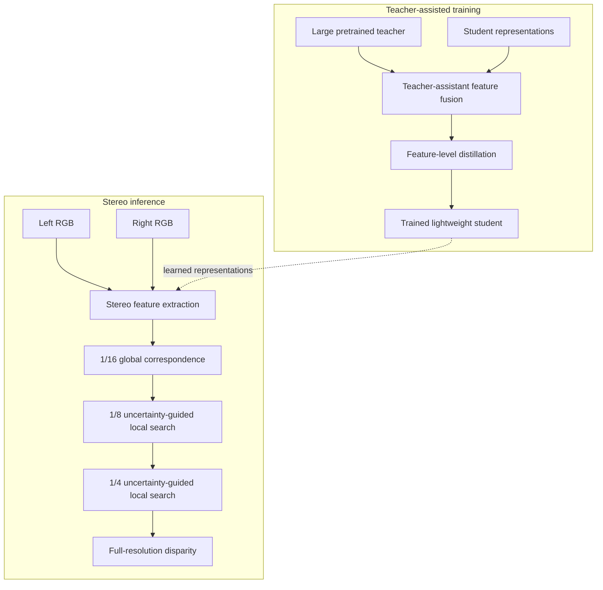

# TRUST-Stereo

### Teacher-Assisted Robust Uncertainty-Guided Search and Transfer for Fast Stereo Matching

**PyTorch implementation · Zero-shot stereo matching · Full-resolution disparity estimation**

TRUST-Stereo is a coarse-to-fine stereo matching framework designed for efficient disparity estimation and strong generalization to unseen domains. It combines **Senior–Junior Teacher Assistant (SJTA)** knowledge distillation with an **Uncertainty-Guided Residual Search Module (UGRSM)** to improve feature representations and recover from errors in propagated disparity.

> **Repository status:** The repository includes a Stage 2 model definition, an inference configuration, and a single-pair inference demo. **To run inference, you also need a compatible TRUST-Stereo checkpoint, the modified Depth Anything V2 implementation used by the model, and the pretrained backbone weights.** See [Required model assets](#required-model-assets) and [Current compatibility notes](#current-compatibility-notes).

## Abstract

Coarse-to-fine stereo matching provides an efficient approach to dense disparity estimation, but errors in propagated disparity can shift subsequent local search windows away from the correct correspondence. Moreover, transferring the rich representations of large monocular foundation models to lightweight stereo networks remains challenging. We propose **TRUST-Stereo (Teacher-Assisted Robust Uncertainty-Guided Search and Transfer for Fast Stereo Matching)**, a coarse-to-fine framework that addresses these complementary limitations. First, a two-stage **Senior–Junior Teacher Assistant (SJTA)** distillation strategy transfers expressive monocular representations to a compact ViT-S backbone. A teacher-enriched intermediate representation is constructed using cross-attention and self-attention, and the lightweight student learns from this representation through feature distillation. Second, an **Uncertainty-Guided Residual Search Module (UGRSM)** estimates the reliability of propagated disparity and predicts residual offsets that adaptively reposition local cost-volume centers before refinement. The combined design improves the robustness of stereo correspondence estimation and supports strong zero-shot generalization across KITTI, ETH3D, and Middlebury. Experiments with approximately **1.4 million synthetic stereo pairs** report **0.95 px EPE on KITTI 2015** and **3.06% Bad 1.0 on ETH3D**.

*The abstract above is a README-oriented adaptation of the research manuscript, not a verbatim quotation of a finalized publication.*

## Highlights

- **Teacher-assisted representation transfer:** SJTA uses a senior–junior teacher-assistant strategy to distill strong foundation-model features into a lightweight stereo backbone.
- **Uncertainty-aware correspondence search:** UGRSM predicts uncertainty-guided residual offsets to reposition local search centers when coarse predictions are unreliable.
- **Coarse-to-fine estimation:** Global stereo matching at **1/16** resolution, followed by local refinement at **1/8** and **1/4** resolution.
- **Zero-shot generalization:** Evaluation on real-world stereo datasets without target-domain fine-tuning.
- **Full-resolution output:** The inference demo produces a disparity map with the same height and width as the input RGB images.

## Method overview



**SJTA** strengthens the feature representation used for stereo correspondence. **UGRSM** targets the separate failure mode in which an inaccurate propagated disparity moves the correct correspondence outside the next local search window. The large teacher/assistant representations are part of the distillation strategy; the full teacher-assistant training procedure is not repeated for every inference pair.

## Repository layout

```text
TRUST-Stereo/
├── config/
│   └── TRUST_inference.yaml
├── core/
│   ├── models/
│   │   └── TRUST_Stereo_Stage2.py
│   └── ...
├── scripts/
│   └── Zero_shot_test_Demo.py
└── README.md
```

The following **additional assets are required by the currently published model code** but are not part of the repository layout shown above:

```text
TRUST-Stereo/
├── Depth-Anything-V2-list_intermediate_level/
│   └── depth_anything_v2/
│       └── dpt.py             # Modified implementation expected by the model
├── pretrained/
│   ├── depth_anything_v2_vits.pth
│   └── depth_anything_v2_vitl.pth
└── checkpoints/
    └── <your-compatible-TRUST-checkpoint>.pth
```

The custom `depth_anything_v2.dpt` module must provide `DepthAnythingV2`, `DepthAnythingV2_decoder`, `IntermediateDPTHead`, and `IntermediateDPTFeatureHead`. **The unmodified upstream Depth Anything V2 repository is not a drop-in replacement for this custom module.**

## Installation

### Requirements

- **Python 3.10** (development environment: **3.10.20**)
- **PyTorch 2.6.0** and **Torchvision 0.21.0**, built for **CUDA 12.4**
- A compatible **NVIDIA CUDA GPU** for the current inference script
- The local source files and checkpoints described in [Required model assets](#required-model-assets)

The package versions below were read from the original training environment, `new_env`. They are **reference versions**, not a claim that a fresh install has been independently validated on every hardware platform.

### 1. Clone the repository

```bash
git clone https://github.com/PouyaSohrabipour/TRUST-Stereo.git
cd TRUST-Stereo
```

### 2. Create a separate environment

```bash
conda create -n trust-stereo python=3.10 -y
conda activate trust-stereo
```

**Do not install into an existing research environment unless you intend to change that environment.** The commands here create and modify only the new `trust-stereo` environment.

### 3. Install PyTorch with CUDA 12.4

```bash
python -m pip install torch==2.6.0 torchvision==0.21.0 --index-url https://download.pytorch.org/whl/cu124
```

### 4. Install the inference-related Python packages

```bash
python -m pip install \
    numpy==2.2.6 \
    scipy==1.15.3 \
    opencv-python==4.12.0.88 \
    Pillow==12.0.0 \
    matplotlib==3.10.8 \
    omegaconf==2.3.0 \
    timm==1.0.27 \
    einops==0.8.2 \
    opt-einsum==3.4.0
```

These packages reflect the inspected source and the working environment. Other imports may be needed by the custom Depth Anything V2 source once it is distributed.

### Optional: Training-related packages

The original training environment also contained:

```bash
python -m pip install \
    accelerate==1.12.0 \
    hydra-core==1.3.2 \
    swanlab==0.7.5 \
    tqdm==4.67.1 \
    PyYAML==6.0.3 \
    scikit-image==0.25.2 \
    imageio==2.37.2
```

These are **not required merely to run the standalone demo** unless one of your local modules imports them. Training scripts, datasets, and full experiment-reproduction instructions are separate from this quick-start guide. The inspected training environment did **not** contain `xformers`, `flash-attn`, or the Hugging Face `transformers` package; they are therefore not listed as required installations.

## Required model assets

Before running the demo, supply:

1. **A compatible TRUST-Stereo Stage 2 checkpoint** (`.pth`). Specify its path with `--weights`.
2. **The modified Depth Anything V2 implementation** expected at `Depth-Anything-V2-list_intermediate_level/depth_anything_v2/`.
3. **Depth Anything V2 pretrained ViT-S and ViT-L weights** at `pretrained/depth_anything_v2_vits.pth` and `pretrained/depth_anything_v2_vitl.pth`, respectively, as currently required by model initialization.

The model constructor loads those backbone weights before the final TRUST-Stereo checkpoint. They are therefore needed with the current implementation even for inference. For information about the original foundation model, see [Depth Anything V2](https://github.com/DepthAnything/Depth-Anything-V2). Be sure to use the appropriate checkpoint sources and observe their licenses.

**Pretrained TRUST-Stereo checkpoint download:** A public checkpoint URL has not yet been documented in this repository. Until one is supplied, use an existing compatible local checkpoint.

## Zero-shot inference

The demo accepts **any pair of equal-sized, rectified RGB stereo images**. No ground-truth disparity map or benchmark-specific dataset loader is required.

From the repository root, run:

```bash
python scripts/Zero_shot_test_Demo.py \
    --left /path/to/left.png \
    --right /path/to/right.png \
    --weights /path/to/trust_stage2.pth \
    --config config/TRUST_inference.yaml \
    --output_dir outputs/example \
    --iters 4
```

**Note:** `--config config/TRUST_inference.yaml` is provided explicitly because the currently published demo script still has an outdated default configuration filename.

### Arguments

| Argument | Description |
|---|---|
| `--left` | Path to the left RGB image (required). |
| `--right` | Path to the right RGB image (required). |
| `--weights` | Path to a compatible TRUST-Stereo `.pth` checkpoint (required). |
| `--config` | YAML configuration; use `config/TRUST_inference.yaml`. |
| `--output_dir` | Output directory; defaults to `outputs/zero_shot`. |
| `--iters` | Number of inference iterations; defaults to `4`. |

### Output files

The script saves these files in `--output_dir`:

| File | Description |
|---|---|
| `disparity.npy` | **Float32 full-resolution disparity**, in pixels. Recommended for downstream processing. |
| `disparity.pfm` | Float32 PFM disparity, in pixels. Useful for stereo tools and evaluation pipelines. |
| `disparity_16bit.png` | Unsigned 16-bit PNG, encoded as `round(disparity × 256)` after clipping to the representable range. |
| `disparity_vis.png` | Colorized disparity preview using the `turbo` colormap. For visualization only. |

The 16-bit PNG can represent nonnegative disparities up to approximately **255.996 pixels**; larger or negative values are clipped. Use `disparity.npy` or `disparity.pfm` to retain the full floating-point prediction.

The demo uses the original input scale, pads the images to a multiple of **32** during inference, and removes the padding before saving. The saved disparity therefore has the **same spatial resolution as the original input images**.

### Using the disparity in Python

```python
import numpy as np

disparity = np.load("outputs/example/disparity.npy")  # [H, W], float32
print("Disparity shape:", disparity.shape)
print("Disparity range:", disparity.min(), disparity.max())
```

**Input assumptions:** The images should be a calibrated/rectified stereo pair with consistent dimensions and a horizontal epipolar geometry. Arbitrary unrelated RGB images or unrectified camera views are not expected to produce geometrically meaningful disparity. Disparity is in **pixels**, not metric depth; conversion to depth requires camera intrinsics and stereo baseline.

## Reported zero-shot results

Selected results reported for the model trained with approximately **1.4 million synthetic stereo pairs**:

| Benchmark | Metric | Reported result |
|---|---|---:|
| KITTI 2015 | EPE ↓ | **0.95 px** |
| ETH3D | Bad 1.0 ↓ | **3.06%** |

These are **research results from the manuscript**, not measurements produced by the single-pair inference demo. Benchmark-specific masks, preprocessing, evaluation conventions, and the exact checkpoint matter when reproducing them. The demo does not compute EPE or Bad-pixel metrics because it does not require ground truth.

## Current compatibility notes

The public source needs the following items addressed for a fully self-contained, reproducible release:

- **Model class name:** `Zero_shot_test_Demo.py` imports `TRUST` from `core/models/TRUST_Stereo_Stage2.py`, while the currently published model file defines `class URS`. The import and class declaration must agree before running the demo. The intended public class name is **`TRUST`**.
- **Configuration default:** The demo's default still refers to an older `URS3_...yaml`. For now, **always pass `--config config/TRUST_inference.yaml`**, as shown above.
- **Custom Depth Anything V2 source:** The model imports classes from a modified local implementation that is not included in the visible repository layout.
- **Pretrained weights:** The model initialization expects the ViT-S and ViT-L checkpoint files under `pretrained/`; a compatible final TRUST-Stereo checkpoint must also be supplied.

These are repository packaging issues, **not** additional Python package installation requirements. If inference fails before the first forward pass, check these items first.

## Reproducibility

The reference development environment used:

| Component | Version |
|---|---|
| Python | `3.10.20` |
| PyTorch | `2.6.0+cu124` |
| Torchvision | `0.21.0+cu124` |
| CUDA version used to build PyTorch | `12.4` |
| Triton | `3.2.0` |
| NumPy | `2.2.6` |
| OpenCV | `4.12.0.88` |
| Accelerate (training) | `1.12.0` |
| Hydra (training) | `1.3.2` |
| SwanLab (training) | `0.7.5` |

A CUDA-enabled PyTorch installation does not guarantee that a GPU is available in the current shell. For example, HPC login sessions often have no allocated CUDA device. Run inference on a CUDA-enabled GPU node.

## Citation

The formal paper citation will be added when a public manuscript identifier or publication record is available. Until then, please refer to this project as:

> **TRUST-Stereo: Teacher-Assisted Robust Uncertainty-Guided Search and Transfer for Fast Stereo Matching**

Related research: [URS-Stereo](https://arxiv.org/abs/2607.06779).

## Acknowledgments

TRUST-Stereo builds on research in stereo correspondence, coarse-to-fine recurrent refinement, and foundation-model feature extraction, including [Depth Anything V2](https://github.com/DepthAnything/Depth-Anything-V2). Please also follow the attribution and license terms of any third-party source code, pretrained models, and datasets used in your experiments.

## License

No explicit license file was visible in the repository at the time this README was prepared. Public repository access does not by itself grant a software license; consult the repository owner before reuse or redistribution.
